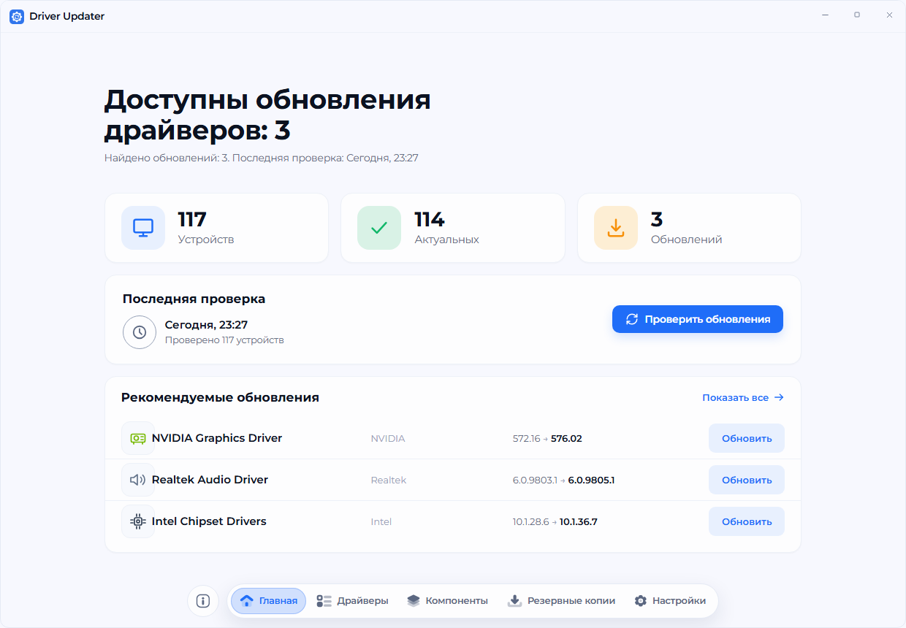
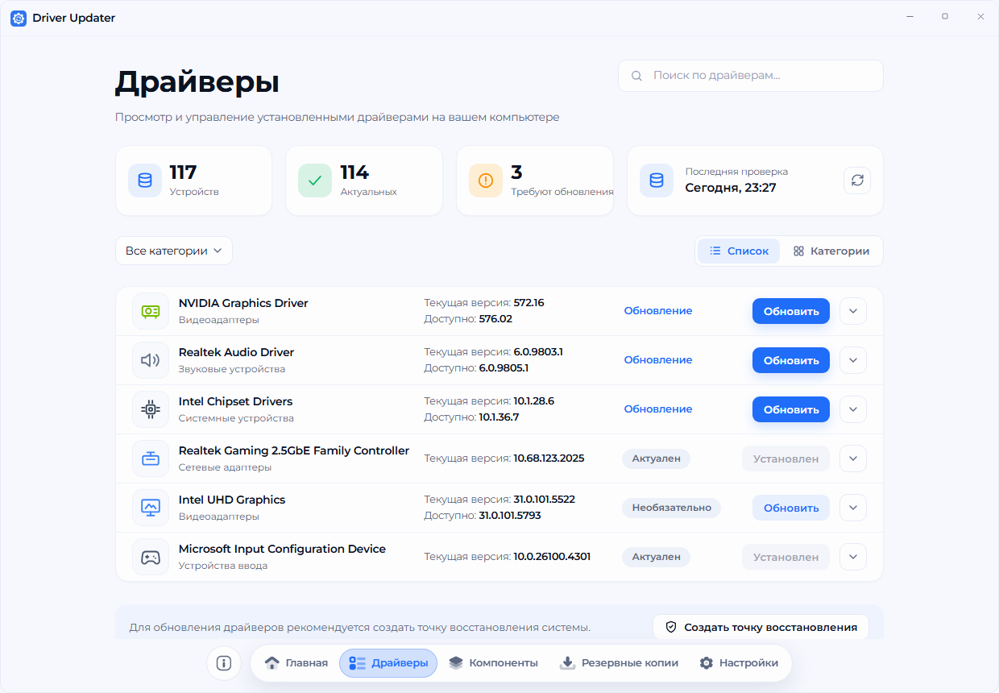
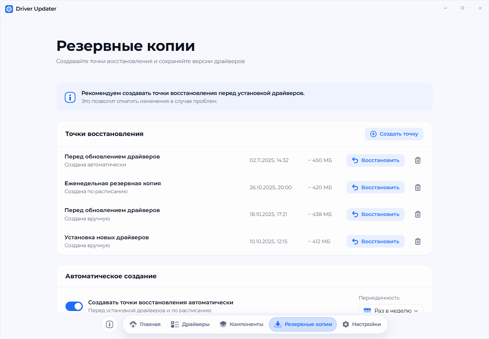
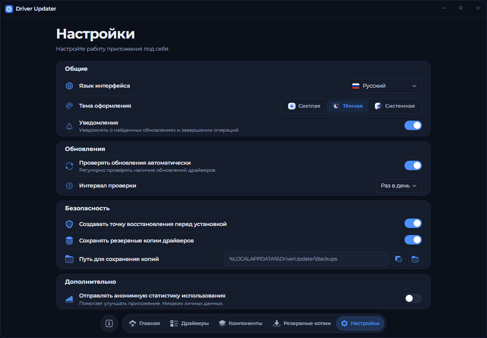
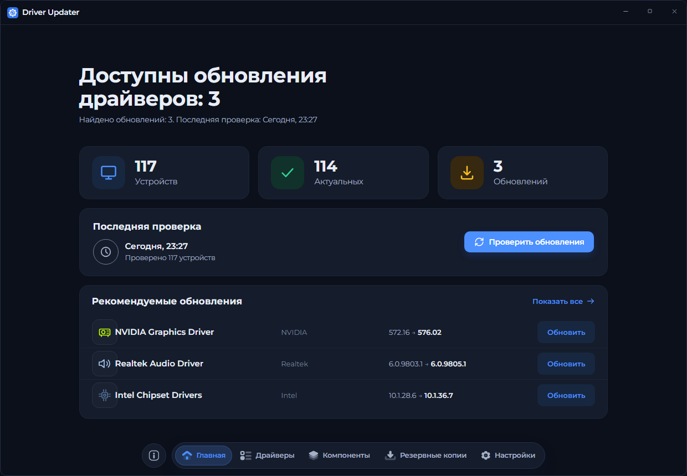

<p align="center">
  
</p>

<h1 align="center">Driver Updater</h1>

<p align="center">
  <b>A native Windows driver manager: inventory, updates, rollback points and portable components.</b><br>
  Tauri 2, Rust and React. Offline-first, no browser chrome, no telemetry by default.
</p>

<p align="center">
  
  
  
  
  
  
  
</p>

<p align="center">
  <picture>
    <source media="(prefers-color-scheme: dark)" srcset="docs/screenshots/home-dark.png">
    
  </picture>
  <br>
  <sub>Live driver inventory, update status and the last scan in one place.</sub>
</p>

> [!NOTE]
> **Project status: early.** Driver and software inventory is read from the real
> Windows system. Update and component installation still go through a repository
> layer with simulated package delivery while the Windows package backend is
> being completed. The UI and IPC contracts are already shaped for the final
> backend.

---

## Contents

- [Why](#why)
- [Features](#features)
- [Screenshots](#screenshots)
- [Requirements](#requirements)
- [Install](#install)
- [Build from source](#build-from-source)
- [Architecture](#architecture)
- [Languages](#languages)
- [Privacy](#privacy)
- [Tests](#tests)
- [Contributing](#contributing)
- [Security](#security)
- [License](#license)

---

## Why

Driver management on Windows usually means guessing. Device Manager shows
devices, not package state. Vendor utilities only know their own hardware.
"Update all" tools often install a package that cannot be rolled back, and a
failed install can leave a machine worse than it started.

Driver Updater keeps the workflow visible:

| Hand-managed drivers | Driver Updater |
|---|---|
| Version information split across Device Manager, vendor tools and the registry | One inventory with device, vendor, current version, available version and size |
| No restore point until something breaks | Optional restore point before install, with a dedicated backups screen |
| Updates silently replace packages | Update state is explicit: current, update, optional |
| English-only utilities | 35 interface languages, including Russian and Ukrainian |
| A web app in a desktop shell | Frameless native window, keyboard-safe layout, no context menu or browser shortcuts |

The project is intentionally local-first. The driver scan reads Windows APIs
through PowerShell/CIM, the UI never talks to a remote service, and anonymous
telemetry is opt-in and disabled by default.

---

## Features

<table>
  <tr>
    <td width="50%" valign="top">
      <h3>Real Windows inventory</h3>
      <p><code>Win32_PnPSignedDriver</code> is queried through CIM, deduplicated by device, version and vendor, cached to the app data directory, and rescanned on demand. A machine with 170+ raw driver records is reduced to a stable, readable list.</p>
      <p>Installed software is detected from the uninstall registry on any drive, including <code>InstallLocation</code> and <code>DisplayIcon</code>, so portable tools outside <code>C:\</code> are not lost.</p>
    </td>
    <td width="50%" valign="top">
      <h3>Restore points and backups</h3>
      <p>Create a restore point manually or automatically before a driver install. Restore points and driver backups are listed with date, origin and estimated size, and can be restored or deleted from the same screen.</p>
      <p>Empty states, animated list resizing and confirmation dialogs make destructive actions explicit instead of silent.</p>
    </td>
  </tr>
  <tr>
    <td width="50%" valign="top">
      <h3>Components without a scavenger hunt</h3>
      <p>A focused catalogue of runtimes and tools: .NET, Visual C++, Python, Node.js, OpenJDK, Go, Rust, PHP, Git, CMake, DirectX and more. Installed versions are detected from the registry and shown next to the package that provides them.</p>
    </td>
    <td width="50%" valign="top">
      <h3>Desktop behaviour, not a website</h3>
      <p>Custom frameless titlebar, a floating bottom dock, no text selection, no permanent scrollbar, no context menu, no devtools shortcuts. Light, dark and system themes are applied before the first paint, and the native window stays hidden until the theme and data are ready.</p>
    </td>
  </tr>
</table>

### Installer prerequisites

The Windows installer embeds the full WebView2 offline installer and runs it
before the app first launches. The MSVC runtime is linked statically. A clean
Windows 10/11 machine does not need a network connection during setup and does
not need a separate Visual C++ Redistributable.

---

## Screenshots

<table>
  <tr>
    <td width="50%" valign="top">
      
      <br>
      <sub>Drivers: search, category filter, list/categories views and expandable details.</sub>
    </td>
    <td width="50%" valign="top">
      
      <br>
      <sub>Backups: restore points, sizes and automatic creation settings.</sub>
    </td>
  </tr>
  <tr>
    <td width="50%" valign="top">
      
      <br>
      <sub>Settings: theme, language, notifications, scan interval and backup path.</sub>
    </td>
    <td width="50%" valign="top">
      
      <br>
      <sub>The same home screen in dark theme. Theme is persisted and restored on launch.</sub>
    </td>
  </tr>
</table>

---

## Requirements

### Running the app

- Windows 10 or Windows 11, x64;
- no separate WebView2 or Visual C++ installation: both are handled by the installer;
- about 250 MB of disk space for the installed app and the offline runtime payload.

### Building

- Node.js 20+ and npm;
- Rust stable with the MSVC toolchain (`rustup default stable-x86_64-pc-windows-msvc`);
- Microsoft C++ Build Tools with the Windows SDK;
- Tauri prerequisites: see [Tauri prerequisites](https://v2.tauri.app/start/prerequisites/).

---

## Install

Download the latest `Driver Updater_<version>_x64-setup.exe` from
[Releases](https://github.com/KirillGrachev/DriverUpdater/releases) and run it.
The installer is per-user by default and does not require a reboot.

The installer:

1. installs the WebView2 runtime from the bundled offline payload when it is
   missing or older than the app expects;
2. links the MSVC runtime into the executable, so no VC++ Redistributable is
   required;
3. copies the app, creates shortcuts and registers the uninstaller.

If a prerequisite cannot be installed, setup stops with an error instead of
leaving a half-working application behind.

---

## Build from source

```powershell
git clone https://github.com/KirillGrachev/DriverUpdater.git
cd DriverUpdater

npm install
npm run tauri dev
```

Create a production build and the NSIS installer:

```powershell
npm run tauri build -- --bundles nsis
```

The installer is written to:

```text
src-tauri/target/release/bundle/nsis/
```

The first Rust build takes a few minutes. Later builds reuse the Cargo cache.

---

## Architecture

Driver Updater keeps the Windows boundary in Rust and the presentation layer in
React. The webview never calls PowerShell directly; it goes through typed IPC
commands, and the repository owns caching and persistence.

```text
src/
  App.tsx                    shell, boot/error states, page switch
  components/                titlebar, bottom dock, UI kit, icons
  pages/                     Home, Drivers, Components, Backups, Settings, About
  store/app.tsx              routing, IPC state, theme, toasts, settings queue
  ipc/                       transport contract + Tauri and browser backends
  i18n/                      ru/en dictionaries, 35 lazy locale bundles
  styles/                    tokens, base, components, pages

src-tauri/src/
  commands.rs                typed Tauri commands and input validation
  repository.rs              driver detection, fixtures, state and restore points
  models.rs                  serde models mirroring src/ipc/types.ts
  lib.rs                     Tauri setup, window icon, backup folder metadata

shared/fixtures/             single source of test data for Rust and TypeScript
```

Flow of a scan:

```text
React action
  -> invoke("check_updates")
  -> Tauri command
  -> DriverRepository
  -> PowerShell / CIM
  -> dedupe + cache + summary
  -> typed JSON back to the webview
```

The same `Backend` interface is implemented twice:

- `TauriBackend` invokes the Rust core;
- `MockBackend` runs in the browser preview and in unit tests against the shared
  fixtures.

This keeps `npm run dev` usable without the native shell and lets UI work
continue when the Windows toolchain is unavailable.

---

## Languages

The interface ships 35 locales in the same order as the
[BirthdayBot](https://github.com/KirillGrachev/BirthdayBot) language picker:

```text
ru uk be en de es fr it pt pl cs sk bg hr sl nl da sv fi et lv lt ro hu
el ga mt kk ky tg tk uz az ka hy
```

Russian and English are the reference dictionaries. Every other locale is a
lazy-loaded JSON chunk under `src/i18n/locales/`, so the initial bundle does not
carry all translations. Missing keys fall back to English, then to Russian.
To add a language, copy an existing JSON file, translate the values, keep the
key structure, and add the locale to `LOCALE_ORDER` in `src/i18n/index.ts` if it
is not listed yet.

---

## Privacy

- Driver and software inventory is read locally.
- Settings, restore points and component state are stored under the app data
  directory and, for the browser preview, in `localStorage`.
- Anonymous telemetry is **off by default**. The setting only records a local
  preference until a telemetry endpoint is implemented.
- External links open in the system browser. The app does not embed a browser
  or load remote content.

---

## Tests

```powershell
npm run typecheck
npm test
npm run build

cargo check --manifest-path src-tauri/Cargo.toml
cargo test --manifest-path src-tauri/Cargo.toml
```

Formatting is enforced with Prettier (4 spaces, 120 columns) and `cargo fmt`:

```powershell
npm run format:check
```

CI runs typecheck, unit tests, the Vite build and a Windows `cargo check`.

---

## Contributing

Read [CONTRIBUTING.md](CONTRIBUTING.md) before opening a pull request. In short:

- keep TypeScript strict and run `npm run typecheck`;
- format with `npm run format` (Prettier + `cargo fmt`);
- add tests for behavior that can regress;
- do not commit generated bundles, `node_modules`, `dist` or `src-tauri/target`;
- use Conventional Commits (`feat:`, `fix:`, `chore:`, `docs:`).

Bug reports and feature requests use the issue templates in
[.github/ISSUE_TEMPLATE](.github/ISSUE_TEMPLATE).

---

## Security

Please do not open a public issue for a vulnerability. See
[SECURITY.md](SECURITY.md) for the reporting process and scope.

---

## License

MIT. See [LICENSE](LICENSE). The bundled Montserrat fonts are distributed under
the SIL Open Font License; see
[src/assets/fonts/OFL.txt](src/assets/fonts/OFL.txt).

---

<p align="center">
  <sub>Built with Tauri, Rust and React. Copyright © 2026 Driver Updater.</sub>
</p>
