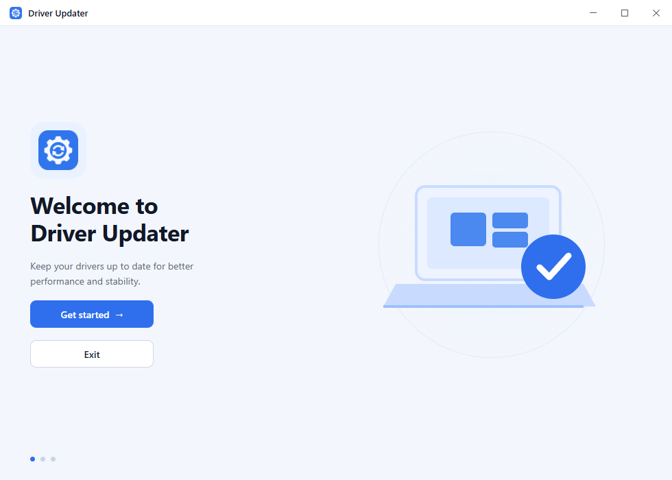
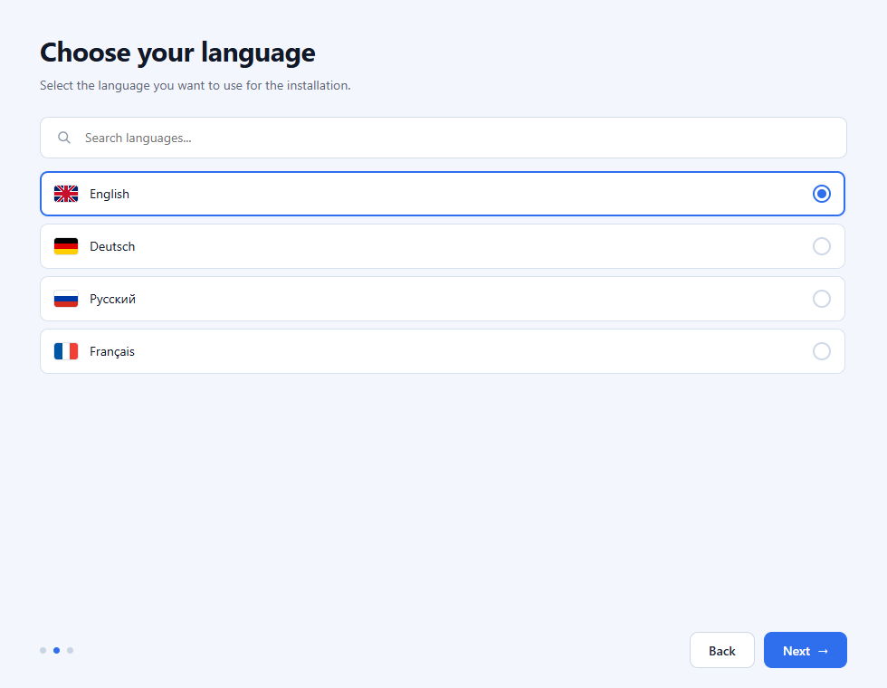
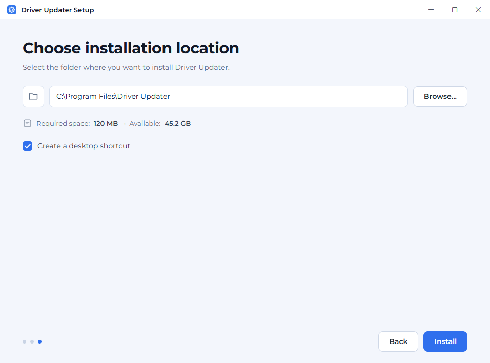

<p align="center">
  
</p>

<h1 align="center">Driver Updater</h1>

<p align="center">
  <b>A native Windows driver manager: inventory, updates, rollback points and portable components.</b><br>
  Tauri 2, Rust and React. Offline-first, no browser chrome, no telemetry.
</p>

<p align="center">
  
  
  
  
  
  
  
</p>

<p align="center">
  <picture>
    <source media="(prefers-color-scheme: dark)" srcset="docs/screenshots/home-dark.png">
    
  </picture>
  <br>
  <sub>Live driver inventory, update status and the last scan in one place.</sub>
</p>

> [!NOTE]
> **Project status: early.** Driver inventory, Windows Update driver discovery,
> restore points and driver-package backups use real Windows APIs. Windows Update
> is currently the only driver source; vendor-specific databases are not wired
> in yet. Component installation uses Windows Package Manager (winget) and
> supports choosing a version.

---

<h2 align="center" id="contents">Contents</h2>

<p align="center">
  <a href="#why">Why</a><br>
  <a href="#features">Features</a><br>
  <a href="#screenshots">Screenshots</a><br>
  <a href="#requirements">Requirements</a><br>
  <a href="#install">Install</a><br>
  <a href="#build-from-source">Build from source</a><br>
  <a href="#architecture">Architecture</a><br>
  <a href="#languages">Languages</a><br>
  <a href="#privacy">Privacy</a><br>
  <a href="#tests">Tests</a><br>
  <a href="#documentation">Documentation</a><br>
  <a href="#contributing">Contributing</a><br>
  <a href="#security">Security</a><br>
  <a href="#license">License</a>
</p>

---

<h2 align="center" id="why">Why</h2>

Driver management on Windows usually means guessing. Device Manager shows
devices, not package state. Vendor utilities only know their own hardware.
"Update all" tools often install a package that cannot be rolled back, and a
failed install can leave a machine worse than it started.

Driver Updater keeps the workflow visible:

<table align="center">
  <tr>
    <th align="left">Hand-managed drivers</th>
    <th align="left">Driver Updater</th>
  </tr>
  <tr><td>Version information split across Device Manager, vendor tools and the registry</td><td>One inventory with device, vendor, current version, available version and size</td></tr>
  <tr><td>No restore point until something breaks</td><td>Optional restore point before install, with a dedicated backups screen</td></tr>
  <tr><td>Updates silently replace packages</td><td>Update state is explicit: current, update, optional</td></tr>
  <tr><td>English-only utilities</td><td>35 interface languages, including Russian and Ukrainian</td></tr>
  <tr><td>A web app in a desktop shell</td><td>Frameless native window, keyboard-safe layout, no context menu or browser shortcuts</td></tr>
</table>

The project is intentionally local-first. The driver scan reads Windows APIs
through native SetupAPI with a CIM fallback, the UI never talks to a remote service, and no telemetry
is collected.

---

<h2 align="center" id="features">Features</h2>

<table align="center">
  <tr>
    <td width="50%" valign="top">
      <h3>Real Windows inventory</h3>
      <p>SetupAPI enumerates present devices, resolves their registry properties, deduplicates by device instance id, caches the result to the app data directory, and rescans on demand. CIM remains a fallback. A machine with 170+ raw driver records is reduced to a stable, readable list.</p>
      <p>Installed software is detected from the uninstall registry on any drive, including <code>InstallLocation</code> and <code>DisplayIcon</code>, so portable tools outside <code>C:\</code> are not lost.</p>
    </td>
    <td width="50%" valign="top">
      <h3>Restore points and backups</h3>
      <p>Create a restore point manually or automatically before a driver install. Restore points and driver backups are listed with date, origin and known size when Windows exposes one, and can be restored or deleted from the same screen.</p>
      <p>Empty states, animated list resizing and confirmation dialogs make destructive actions explicit instead of silent.</p>
    </td>
  </tr>
  <tr>
    <td width="50%" valign="top">
      <h3>Components without a scavenger hunt</h3>
      <p>A version-aware catalogue split into runtimes, languages, SDKs and tools: .NET Framework, .NET Desktop 6-10, ASP.NET Core 8-10, Visual C++ including ARM64, DirectX, WebView2, XNA, Vulkan, OpenAL, PhysX and CUDA; Python 3.10-3.14, Node.js 20/22, OpenJDK 17/21/25, Go, Rust, PHP 8.2-8.5, Ruby, Dart, Perl, R, Bun, Deno and Swift; .NET SDK 10, Windows SDK, Vulkan SDK and LLVM; Visual Studio 2022, Build Tools, VS Code, Docker, Ninja, PowerShell, WSL, GitHub CLI, Windows Terminal, NASM, PostgreSQL, MySQL, SQLite, Chocolatey, Git, CMake and 7-Zip.</p>
      <p>Each row exposes the versions available from winget. Installed versions are detected from the registry; chosen versions are installed through the Windows Package Manager.</p>
    </td>
    <td width="50%" valign="top">
      <h3>Desktop behaviour, not a website</h3>
      <p>Custom frameless titlebar, a floating bottom dock, no text selection, no permanent scrollbar, no context menu, no devtools shortcuts. Light, dark and system themes are applied before the first paint; the native window is shown on the first React commit with a themed boot splash while the blocking scan finishes.</p>
    </td>
  </tr>
</table>

<h3 align="center">Installer prerequisites</h3>

The Windows installer downloads the small Microsoft WebView2 bootstrapper when
the runtime is missing, then launches the app. The MSVC runtime is linked
statically, so a separate Visual C++ Redistributable is not required. Setup
therefore needs an internet connection on a clean Windows 10/11 machine.

<h3 align="center">Component installation</h3>

Components use winget and need the **App Installer** (`winget`) from the
Microsoft Store. If winget is unavailable, the components page reports the
failure instead of pretending the package was installed.

- The version selector is populated from `winget show --versions`; the bundled
  list is only a fallback while that request is in flight.
- Installing Visual Studio, .NET runtimes or DirectX can take several minutes,
  needs a network connection and may show a Windows UAC prompt.
- The Rust allowlist in `src-tauri/src/packages.rs` restricts package ids; the
  webview cannot ask winget to install an arbitrary package.

---

<h2 align="center" id="screenshots">Screenshots</h2>

<table align="center">
  <tr>
    <td width="50%" align="center" valign="top">
      
      <br>
      <sub>Drivers: search, category filter, list/categories views and expandable details.</sub>
    </td>
    <td width="50%" align="center" valign="top">
      
      <br>
      <sub>Backups: restore points, sizes and automatic creation settings.</sub>
    </td>
  </tr>
  <tr>
    <td width="50%" align="center" valign="top">
      
      <br>
      <sub>Settings: theme, language, automatic checks, restore points and backup path.</sub>
    </td>
    <td width="50%" align="center" valign="top">
      
      <br>
      <sub>The same home screen in dark theme. Theme is persisted and restored on launch.</sub>
    </td>
  </tr>
</table>

---

<h2 align="center" id="requirements">Requirements</h2>

<h3 align="center">Running the app</h3>

- Windows 10 or Windows 11;
- x64, ARM64 or 32-bit x86 (x86 is Windows 10 only);
- the installer downloads the WebView2 bootstrapper only when the runtime is missing;
- the MSVC runtime is linked statically;
- the unified setup UI itself needs WebView2; on a clean Windows 10 image, setup installs it before the app first launches;
- about 25 MB for the installed app, plus the shared WebView2 runtime.

<h3 align="center">Building</h3>

- Node.js 20+ and npm;
- Rust stable with the MSVC toolchain (`rustup default stable-x86_64-pc-windows-msvc`);
- Microsoft C++ Build Tools with the Windows SDK;
- Tauri prerequisites: see [Tauri prerequisites](https://v2.tauri.app/start/prerequisites/).

---

<h2 align="center" id="install">Install</h2>

Download the installer for your architecture from
[Releases](https://github.com/KirillGrachev/DriverUpdater/releases):

<table align="center">
  <tr>
    <th align="left">Architecture</th>
    <th align="left">Recommended asset</th>
  </tr>
  <tr><td>Windows x64</td><td><code>DriverUpdaterSetup-x64.exe</code></td></tr>
  <tr><td>Windows ARM64</td><td><code>DriverUpdaterSetup-arm64.exe</code></td></tr>
  <tr><td>Windows 10 x86</td><td><code>DriverUpdaterSetup-x86.exe</code></td></tr>
</table>

The `.exe` is the normal installer. The matching
<code>DriverUpdaterSetup-&lt;version&gt;-&lt;arch&gt;.zip</code> is the fallback for
managed deployment and contains the MSI/NSIS payload. Raw MSI and NSIS payloads
are not published as separate assets because they show the native Windows
Installer UI. Portable and symbol archives remain available for
architecture-specific automation.

<table align="center">
  <tr>
    <td width="50%" align="center" valign="top">
      
      <br>
      <sub>Unified setup: branded welcome, language, appearance and location steps.</sub>
    </td>
    <td width="50%" align="center" valign="top">
      
      <br>
      <sub>The same wizard is used for x64, ARM64 and x86 builds.</sub>
    </td>
  </tr>
  <tr>
    <td colspan="2" align="center" valign="top">
      
      <br>
      <sub>Choose the install folder and whether to create a desktop shortcut before installing.</sub>
    </td>
  </tr>
</table>

The installer installs for all users and requires administrator rights; it does not require a reboot.

The setup registers a small `DriverUpdaterService` LocalSystem service and
writes a per-user IPC token. The app itself runs with normal user rights, and
the service performs only allowlisted privileged operations: driver updates,
restore points and driver backups. This gives one UAC prompt at setup and no
prompt for each driver. The portable archive does not register the service; use
the setup executable for driver installation and restore-point features.

The installer:

1. applies the selected language and theme on the first app launch;
2. downloads and runs the Microsoft WebView2 bootstrapper when the runtime is
   missing or older than the app expects;
3. links the MSVC runtime into the executable, so no VC++ Redistributable is
   required;
4. copies the app, creates shortcuts and registers the uninstaller.

If a prerequisite cannot be installed, setup stops with an error instead of
leaving a half-working application behind.

---

<h2 align="center" id="build-from-source">Build from source</h2>

```powershell
git clone https://github.com/KirillGrachev/DriverUpdater.git
cd DriverUpdater

npm install
npm run tauri dev
```

Create the MSI/NSIS payload and the unified setup wizard for the native
architecture:

```powershell
npm run tauri build -- --bundles msi nsis
./scripts/build-setup.ps1 -Target x86_64-pc-windows-msvc
```

For a specific Windows target:

```powershell
npm run tauri -- build --target aarch64-pc-windows-msvc --bundles msi nsis
./scripts/build-setup.ps1 -Target aarch64-pc-windows-msvc
npm run tauri -- build --target i686-pc-windows-msvc --bundles msi nsis
./scripts/build-setup.ps1 -Target i686-pc-windows-msvc
```

The native bundles are written to:

```text
src-tauri/target/release/bundle/nsis/
```

The first Rust build takes a few minutes. Later builds reuse the Cargo cache.

---

<h2 align="center" id="architecture">Architecture</h2>

Driver Updater keeps the Windows boundary in Rust and the presentation layer in
React. The webview never calls PowerShell directly; it goes through typed IPC
commands, and the repository owns caching and persistence.

```text
src/
  App.tsx                    shell, boot/error states, page switch
  components/                titlebar, bottom dock, UI kit, icons
  pages/                     Home, Drivers, Components, Backups, Settings, About
  store/app.tsx              routing, IPC state, theme, toasts, settings queue
  ipc/                       transport contract + Tauri and browser backends
  i18n/                      ru/en dictionaries, 35 lazy locale bundles
  styles/                    tokens, base, components, pages

src-tauri/src/
  commands.rs                typed Tauri commands, validation and blocking-pool boundary
  repository.rs              application service, locking and persistence
  detection.rs               detector traits and native Windows detection adapters
  windows_update.rs          Windows Update driver discovery and installation
  restore.rs                 System Restore points through srclient and WMI
  backup.rs                  driver package export and restore through pnputil
  storage.rs                 versioned encrypted state and driver cache
  security.rs                DPAPI sealing for files at rest
  models.rs                  serde models mirroring src/ipc/types.ts
  lib.rs                     Tauri setup, window icon, backup folder metadata

shared/fixtures/             single source of test data for Rust and TypeScript
```

Flow of an update check:

```text
React action
  -> invoke("check_updates")
  -> driver scan and Windows Update search run outside the state lock
  -> typed repository update + persist
  -> dedupe + HardwareID matching + cache + summary
  -> typed JSON back to the webview
```

The same `Backend` interface is implemented twice:

- `TauriBackend` invokes the Rust core;
- `MockBackend` runs in the browser preview and in unit tests against the shared
  fixtures.

This keeps `npm run dev` usable without the native shell and lets UI work
continue when the Windows toolchain is unavailable.

The native detection and update design, including the Driver Booster research,
is documented in [docs/architecture/driver-detection.md](docs/architecture/driver-detection.md).

---

<h2 align="center" id="languages">Languages</h2>

The interface ships 35 locales in the same order as the
[BirthdayBot](https://github.com/KirillGrachev/BirthdayBot) language picker:

```text
ru uk be en de es fr it pt pl cs sk bg hr sl nl da sv fi et lv lt ro hu
el ga mt kk ky tg tk uz az ka hy
```

Russian and English are the reference dictionaries. Every other locale is a
lazy-loaded JSON chunk under `src/i18n/locales/`, so the initial bundle does not
carry all translations. Missing keys fall back to English.
To add a language, copy an existing JSON file, translate the values, keep the
key structure, and add the locale to `LOCALE_ORDER` in `src/i18n/index.ts` if it
is not listed yet.

---

<h2 align="center" id="privacy">Privacy</h2>

<h3 align="center">Local data protection</h3>

Persisted application data is encrypted at rest with Windows DPAPI in the
current-user scope. The payload is additionally bound to stable application-specific DPAPI
entropy. A copied profile, a file taken from another
Windows account, or an offline disk image cannot be decrypted with this app
alone.

Encrypted files:

- `state.json`: settings, restore points and component state;
- `installed-drivers.json`: the only persisted driver inventory.

Legacy plaintext files are read once and rewritten in encrypted form. Writes use
a temporary file plus rename to avoid truncated state after a crash.

DPAPI raises the cost of offline data theft. It does **not** stop malware already
running as the same logged-in user: that user can ask DPAPI to decrypt the files.
Full disk encryption, a clean machine and OS-level account security remain part
of the threat model.

- Driver and software inventory is read locally.
- Settings, driver cache, restore points and component state are stored as
  DPAPI-sealed files under the app data directory. The files are bound to the
  current Windows user with an application-specific entropy value.
- The browser preview uses `localStorage`; it contains only fixture state and is
  never used by the desktop build.
- Theme preference is the only desktop `localStorage` value; it contains a
  single word (`light`, `dark` or `system`).
- No telemetry is collected.
- Component installs download packages from the configured winget sources.
- Setup downloads the WebView2 bootstrapper from Microsoft when needed.
- External links open in the system browser. The app does not embed a browser
  or load remote content.

---

<h2 align="center" id="tests">Tests</h2>

```powershell
npm run typecheck
npm test
npm run build

cargo check --manifest-path src-tauri/Cargo.toml
cargo test --manifest-path src-tauri/Cargo.toml
```

Formatting is enforced with Prettier (4 spaces, 120 columns) and `cargo fmt`:

```powershell
npm run format:check
```

CI runs Prettier, typecheck, unit tests, the Vite build, version consistency, production npm audit,
clippy with warnings as errors, `cargo fmt`, `cargo check`, Rust unit tests on Linux and Windows, and
the RustSec advisory audit. The release workflow also builds the unified setup
wizard, smoke tests the MSI and NSIS payloads and publishes a CycloneDX SBOM.

---

<h2 align="center" id="documentation">Documentation</h2>

<p align="center">
  <a href="docs/README.md">Documentation index</a> ·
  <a href="docs/CONTRIBUTING.md">Contributing</a> ·
  <a href="docs/SECURITY.md">Security policy</a> ·
  <a href="docs/CODE_OF_CONDUCT.md">Code of Conduct</a> ·
  <a href="docs/THIRD_PARTY_NOTICES.md">Third-party notices</a> ·
  <a href="docs/architecture/driver-detection.md">Driver detection research</a> ·
  <a href="docs/CODE_SIGNING.md">Code signing</a>
</p>

Developer-only scripts live in `scripts/`. They are used by CI and maintainers,
and are not bundled into the installer.

<h2 align="center" id="contributing">Contributing</h2>

Read [CONTRIBUTING.md](docs/CONTRIBUTING.md) before opening a pull request. In short:

- keep TypeScript strict and run `npm run typecheck`;
- format with `npm run format` (Prettier + `cargo fmt`);
- add tests for behavior that can regress;
- do not commit generated bundles, `node_modules`, `dist` or `src-tauri/target`;
- use Conventional Commits (`feat:`, `fix:`, `chore:`, `docs:`).

Bug reports and feature requests use the issue templates in
[.github/ISSUE_TEMPLATE](.github/ISSUE_TEMPLATE).

---

<h2 align="center" id="security">Security</h2>

Please do not open a public issue for a vulnerability. See
[SECURITY.md](docs/SECURITY.md) for the reporting process and scope.

---

<h2 align="center" id="license">License</h2>

MIT. See [LICENSE](LICENSE). The bundled Montserrat fonts are distributed under
the SIL Open Font License; see
[src/assets/fonts/OFL.txt](src/assets/fonts/OFL.txt).

---

<p align="center">
  <sub>Built with Tauri, Rust and React. Copyright © 2026 Driver Updater.</sub>
</p>
