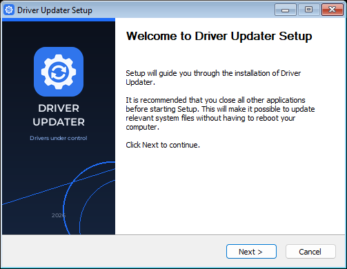

# Getting Started

## Requirements

- Windows 10 or Windows 11, x64.
- The latest installer from [Releases](https://github.com/KirillGrachev/DriverUpdater/releases).
- Windows App Installer (`winget`) for component installation. It is included
  with current Windows 10/11 builds; if it is missing, install App Installer
  from the Microsoft Store.

The app installer embeds the WebView2 offline runtime and statically links the
MSVC runtime. A separate WebView2 or Visual C++ Redistributable installation is
not required.

## Install

1. Download the installer for your architecture from Releases.
2. Run the installer. It installs per-user by default.
3. Approve the Windows UAC prompt if the installer requests it.
4. Launch Driver Updater from the Start menu.

The first launch shows a themed boot splash while the driver inventory is read.
The window itself is shown only when the webview is ready, so there is no white
frame.

## First scan

The Home page shows the last scan, device counts and recommended updates. Select
**Check for updates** to rescan the machine. The result is cached in the app data
directory in encrypted form.

## Restore points

Open **Backups** to create a restore point before installing a driver. Restore
points and driver backups can be restored or deleted from the same page.

## Components

Open **Components** to install runtimes and tools. Use the version selector on a
row to choose an exact winget version. Visual Studio, .NET and DirectX can take
several minutes and may require a UAC prompt.

OpenGL has no standalone installer; it comes with the GPU driver.

## Languages and themes

Settings supports light, dark and system themes plus 35 interface languages.
Changes are saved immediately and survive a restart.
